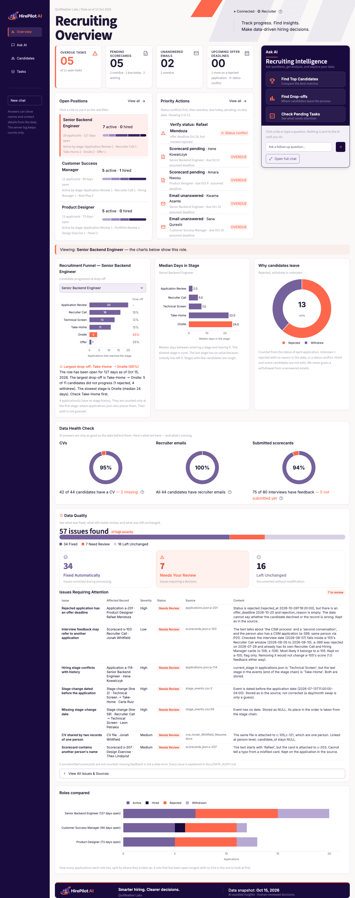
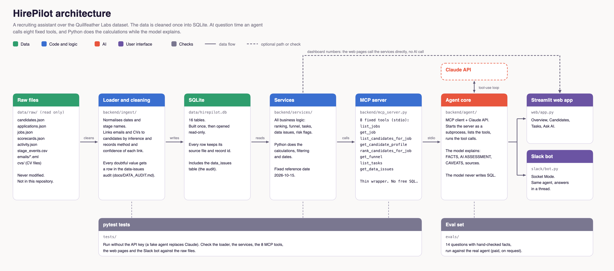
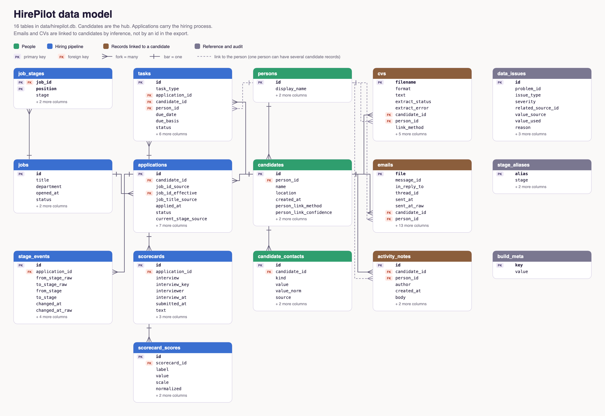
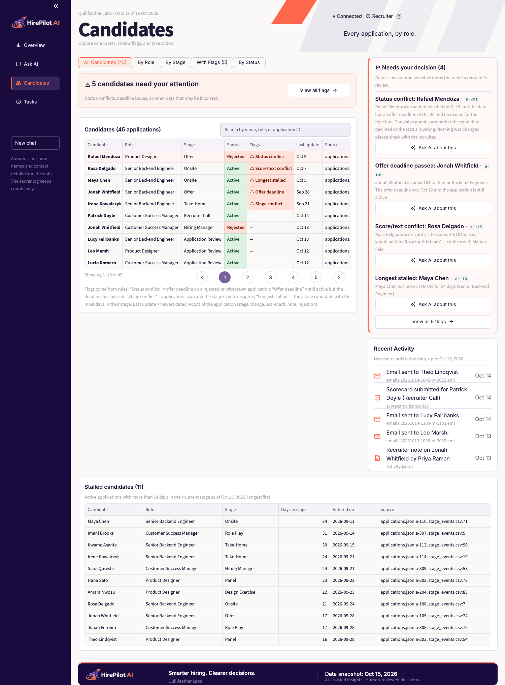
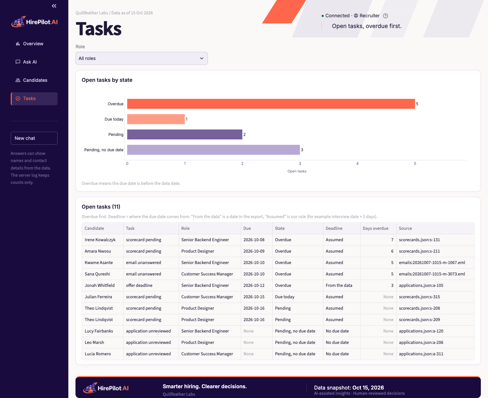
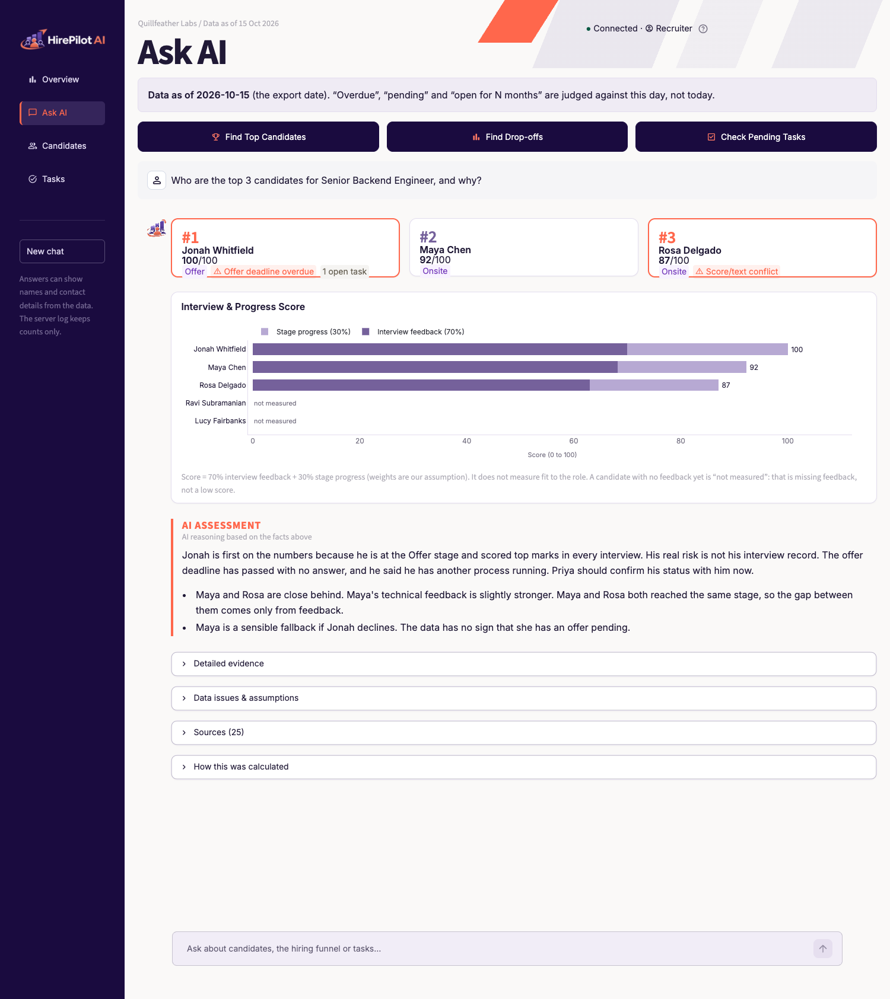

# HirePilot AI

HirePilot AI is a recruiting assistant that helps recruiters find the right candidates, identify hiring delays, and keep track of pending tasks. Recruiters can ask questions in plain English and get answers based on real data. Python handles the calculations, while AI analyzes the results and explains them in a clear, easy-to-understand way.

**What's inside**

- **Data** — the ATS export, mailbox and CVs cleaned into SQLite. 57 data issues found: 34 fixed automatically, 7 flagged for a recruiter to review, 16 documented and left as they are ([details](docs/DATA_AUDIT.md)).
- **MCP server** — 8 fixed tools with clear inputs; the model never writes SQL.
- **Agent** — Claude calls the tools and answers with facts, its assessment and caveats kept separate, plus a source for every fact.
- **Two interfaces** — a Streamlit web app (dashboard + chat) and a Slack bot, both using the same agent.
- **Checked** — 390 automated tests against the raw data, and a 14-question eval set run on the real model (13/14 pass).





A recruiting assistant. A recruiter asks a question in plain English, and an AI agent answers it using tools
that read a recruiting export. The data is fictional: it is the hiring data of "Quillfeather Labs".

It answers three questions:

1. Who are the top 3 candidates for a role, and why?
2. A role has been open for 4 months. Where is our process losing candidates?
3. Which tasks are pending or overdue?

All dates use one fixed day, **2026-10-15** (the date of the export), not today's date.

## Setup

Python 3 is needed. Run every command from the project folder.

The dataset is **not** in this repository (`data/raw/` and `data/*.db` are git-ignored). Put the dataset bundle in `data/raw/`
first (see `data/README.md`), then build the database. The tests, the web app and the evals all need it.

```bash
python3 -m venv .venv
.venv/bin/pip install -r requirements.txt
cp .env.example .env            # then put your key in .env: ANTHROPIC_API_KEY=...
# put the dataset bundle in data/raw/ , then:
.venv/bin/python scripts/build_db.py          # builds data/hirepilot.db from data/raw/ (free)
.venv/bin/streamlit run web/app.py            # the web app: an AI question costs money (about $0.03-0.10); everything else is free
.venv/bin/python -m pytest                    # all tests (free, no API key needed)
```

Evals (they call the real model, so they cost money):

```bash
.venv/bin/python -I evals/run_evals.py --list        # free: shows the questions and checks
.venv/bin/python -I evals/build_expected.py          # free: prints the expected facts with raw file and record ids
.venv/bin/python -I evals/run_evals.py --yes         # PAID: runs the real agent on all 14 questions
```

Fonts: Inter (regular, medium, semibold, bold; woff2, latin) is bundled in `assets/fonts/` with its SIL OFL licence, so the app looks the same without internet. Streamlit serves the copy in `web/static/fonts/` (`enableStaticServing` in `.streamlit/config.toml`; it does not follow symlinks, so the files are copied, and a test checks they are identical). The mono font falls back to the system monospace.

The key lives only in `.env` (it is git-ignored). It is never printed or logged.
The web app, the eval runner and `scripts/smoke_agent.py` are the only parts that call the Claude API.

## Slack bot (demo)

The bot is in `slack/bot.py`. It uses Slack Bolt in Socket Mode, so it needs no public web address. It calls the same agent as
the web app (`core.ask_sync`) and contains no business logic.

How it behaves:
- An @mention in a channel, or a direct message, starts a thread. The bot always answers inside the thread.
- It first posts "Working on it…", then replaces that message with the answer. A very long answer is split into more messages.
- A reply in the same thread (an @mention again in a channel; no mention needed in a direct message) sends the earlier messages of
  that thread to the agent as history, with the same cap as the web app (6 earlier question/answer pairs).
- The answer is rewritten from markdown to Slack formatting. Tables go into a code block, because Slack has no tables.
- The last line says which tools were used and the estimated cost, for example `Tools: get_funnel, list_jobs · est. cost $0.03`.
- Errors are shown as short friendly messages. No traceback and no API key are ever sent. Logs hold counts only.

**Who may use it.** Set `SLACK_ALLOWED_USER_IDS` in `.env` to a comma-separated list of Slack user ids (they look like `U01ABCDEF`).
**If it is empty, everyone in the Slack workspace can use the bot, and every question costs money.** For the demo, put only your own id.
To find your id in Slack: click your profile picture, open your profile, choose the three dots, then "Copy member ID".

Create the Slack app (about 10 minutes, in the browser):
1. Go to https://api.slack.com/apps, choose **Create New App**, then **Paste a manifest**. Pick your workspace, open the **YAML** tab,
   delete the sample text in the field first (otherwise Slack creates a "Demo App" from its example), and paste the content of
   `slack/manifest.yaml`.
2. Under **Basic Information**, then **App-Level Tokens**, generate a token with the scope `connections:write`. Copy the `xapp-` token.
3. Under **Install App**, install the app to the workspace. Copy the Bot User OAuth Token (`xoxb-`) shown after install.
4. Copy your member ID: click your profile picture, open your profile, then **⋮ > Copy member ID**.
5. Fill four variables in `.env`: `ANTHROPIC_API_KEY`, `SLACK_BOT_TOKEN` (the `xoxb-` token), `SLACK_APP_TOKEN` (the `xapp-` token)
   and `SLACK_ALLOWED_USER_IDS` (your member ID).
6. Run `.venv/bin/python -I slack/bot.py`. It prints how many users are on the allowlist.
7. In Slack, open the app (under Apps) and send a direct message. For a channel, invite it with `/invite @HirePilot`, then mention it.

Tokens go only in `.env`. Never put them in code, chat or git.

The manifest asks only for these bot scopes: `app_mentions:read`, `chat:write`, `im:history`, `channels:history`, `groups:history`.

## Architecture

```
data/raw/ (original export, read only)
   |  backend/ingest/        load, clean, link, record every problem
   v
data/hirepilot.db (SQLite, opened read-only)
   |
backend/services/            ALL business logic: ranking, funnel, tasks, dates
   |
backend/mcp_server.py        thin wrapper: 8 tools, no logic of its own
   |  stdio (list_tools / call_tool)
backend/agent/               MCP client + Claude API tool loop
   |
web/app.py                   Streamlit chat          slack/bot.py   Slack bot (Socket Mode)
                             (both call the same agent: core.ask_sync)
web/dashboard.py             Overview page (KPIs, positions, funnel, data quality): no model call
                             web/panel.py + web/chat.py: the AI panel and chat (the only part that calls the agent)
   |  reads backend/services/analytics.py, which only combines the existing services
```

The agent starts the MCP server as a subprocess, asks it for the tool list, gives the tools to Claude, and runs
the tool calls Claude asks for.

## Data model



16 tables in `data/hirepilot.db`. Candidates are the hub. Applications carry the hiring process. Emails and CVs are linked to candidates by inference, not by an id in the export.

The diagram is drawn from the real SQLite schema (SVG: `docs/images/data_model.svg`). To redraw both diagrams after a schema change: `.venv/bin/python scripts/make_diagrams.py` (add `--png` for the PNG files; needs `playwright`).

## Data problems

The audit found 19 problems. Full detail, with file and record ids: [docs/DATA_AUDIT.md](docs/DATA_AUDIT.md).
Every cleaning decision is written there and stored in the `data_issues` table (62 rows after loading; 5 of them are unsubmitted scorecards, which mean "no feedback yet", so the web app counts 57 data issues: 34 fixed automatically, 7 for a recruiter to review, 16 left unchanged).

| Problem | What we did |
|---|---|
| One person stored twice (Jonah Whitfield, c-105 and c-121) | Merged into one person; the tools show the other record |
| Two different people with one name (both "Maya Chen") | Kept apart; links by name alone are not trusted |
| Stage history disagrees with the application (a-114, a-116) | a-116: the end of its stage chain is used. a-114: the conflict is stored and shown |
| Application a-113 has the wrong job | Treated as a backend application (author decision), recorded |
| Mixed date formats in the stage history | Normalized; the rule is stored per row |
| Scores on different scales, inside free text | Read with a pattern and turned into 0 to 1 |
| Empty scorecards (5) | "No feedback yet", not negative |
| Application a-201 is "rejected" at the Offer stage but has a future offer deadline | Left as in the source and flagged; the answer shows the conflict |
| No tasks file, no role requirements, no due dates for most tasks | Tasks are built from the data; see assumptions and limitations |

## App

Candidates (filters, flags, search, paging), Tasks, and Ask AI with a real agent answer to "Who are the top 3 candidates for Senior Backend Engineer, and why?":







## Web app pages

The sidebar has four pages: **Overview**, **Ask AI**, **Candidates**, **Tasks**. Every page shows the data date (15 Oct 2026) and a
live "Connected / Disconnected" status. The status comes from starting the MCP server and listing its tools; it calls no AI model.

**Overview** (free, no model call). Top section, next to the AI panel: four clickable KPI cards (overdue tasks, pending scorecards,
unanswered emails, upcoming offer deadlines; a click opens the records, a second click closes them), then Open Positions (a click sets
the role filter; the selected role has a coral bar and "Viewing: <role>" shows above the role charts) and Priority Actions (status
conflicts first, then overdue, due today, pending, no due date). Full width below: Recruitment Funnel, Median Days in Stage and
"Why candidates leave" (a donut: rejected / withdrew / unknown, from application status only, never from emails); "Data Health
Check" (three coverage rings, each with one plain sentence, e.g. "42 of 44 candidates have a CV — 2 missing"); "Data Quality" (approved layout: issues found + high severity, a stacked bar fixed / need review / left unchanged with hover tooltips, three equal cards, "Issues Requiring Attention" with the unresolved issues, affected record, severity, source and the audit's own explanation, and an expander "View All Issues & Sources" with a grouped table, a table of every record, and resolution and severity filters; numbers come from `backend/services/trust.py`); Roles compared. Recent Activity and "Needs your decision" now live on the
Candidates page.

**Candidates** (free). Filter tabs (All, By Role, By Stage, With Flags, By Status), a coral banner with the number of flagged candidates and
"View all flags", search by name, role or application id, a table of 10 rows per page with Status and Flags columns (flags come from rules in
`trust.application_flags`) and Last update (newest dated record of the application). Right column: "Needs your decision" and Recent
Activity. The Stalled candidates table stays below. The footer sits at the bottom of the window on short pages and after the content on
long ones; the Ask AI page has no footer.

**AI panel** (right of the Overview). Three tiles send the three assignment questions to the real agent (only when clicked). The panel
shows a short summary of the latest answer: three rows (rank, name, score, stage, one risk flag) from the ranking tool result for Top
Candidates, or the first paragraph of FACTS. "Read full answer" and "Open full chat" open the Ask AI page with the same stored answer
(no new call). There are no cost labels anywhere in the app.

**Ask AI** (the full answer). The same three buttons, horizontal. The layout depends on which question was asked (the button, or the tools
the agent used), never on reading the answer text. Top candidates: three cards (rank, name, score, stage, rule-based risk flags such as
"Offer deadline overdue" or "2 open tasks") and the "Interview & Progress Score" chart; drop-offs: funnel, median days and exits donut from
the services; tasks: counts and the task table, most urgent first. Then AI ASSESSMENT, then collapsed expanders: Detailed evidence (FACTS),
Data issues & assumptions (CAVEATS), Sources (N) (readable labels from a database lookup, grouped by candidate, raw reference in small
text) and How this was calculated. Candidate names are bold and coloured. Every page ends with the same footer (normal flow, not fixed).

**Rules that are not MCP tools** (`backend/services/trust.py`, tested against the raw files): *status conflict* = an offer deadline on a
rejected or withdrawn application (flagged, never corrected); *exit* = rejected or withdrawn; *unknown exit* = rejected with no reason or a
status conflict; *coverage* = people with a CV / with an email, and submitted scorecards, each out of its stated total. Source labels are in
`backend/services/sources.py`.

How the funnel is counted: the bar is the number of applications that reached the stage. The % at the right of a bar is the drop-off
from the previous stage: (rejected + withdrew there) / reached there. Candidates still waiting at a stage are not lost, so they are
not counted; the tooltip shows them as "still in progress". The stage with the largest drop-off is coral. The text under the chart is
built in Python, not by the model.

**Candidates** (with the stalled-candidates table and the status-conflict flag) and **Tasks** (with the tasks-by-state
chart) are read-only tables with a role filter. Tables show every row; the page scrolls, not the table.

All numbers come from `backend/services/analytics.py`, which only combines the existing services, so the Overview and the assistant
cannot disagree. Tests cross-check the funnel, task, KPI and stalled numbers against the raw files.


## Key design decisions

- **Python calculates, the model explains.** Ranking, counting, filtering and dates are plain Python. A language
  model is not reliable for arithmetic or date rules, and a Python result can be tested.
- **The model never writes SQL.** It can only call 8 fixed tools. It cannot read or change anything else.
- **All logic is in `backend/services/`.** The MCP server and the tests call the services, so there is one place to fix a bug.
- **The database is opened read-only** while the app runs.
- **Missing is not negative.** A scorecard with no text means "no feedback yet". Such candidates are listed
  separately and are not ranked low.
- **Every link is recorded with its method and confidence** (emails, CVs, duplicate people), and every source row keeps its file and id.
- **Conflicts are shown, not hidden.** Where two sources disagree, the answer says so.
- **Answers are checked by rules.** A small style checker blocks internal ids, closing offers ("want me to...?")
  and "I did not check" in answers.

## Assumptions

These are our choices, not facts in the data. They live only in `backend/config.py`.

- A scorecard is **overdue 2 days** after the interview date.
- A candidate email is **unanswered after 3 days** with no staff reply in the thread.
- Ranking score = **70% interview feedback + 30% progress** through the stages.
- The reference date is **2026-10-15**.

An offer deadline is real data. Overdue means the due date is before the reference date. A task due on that day
is "due today". A task with no due date is "pending, no due date" and is never overdue.

## Known limitations

- The data has **no role requirements**, so ranking does not measure fit to the role. Answers must say this.
- The 2-day, 3-day and 70/30 values are assumptions. Other values give other results.
- One scorecard is thin evidence. Later funnel stages have only a few cases, so averages there are not precise.
- Scores are read from text with a pattern. A different phrasing would be missed.
- The ranking uses numeric scores only. Text verdicts are caught by the "Score/text conflict" flag (`backend/services/score_conflict.py`, a short phrase list: it can miss other wordings and can flag a phrase about someone else) and by the agent, not by the formula.
- Onsite cards from different interviewers cover different topics (for example collaboration and system design) but are
  averaged into one interview score. Word-only ratings such as "Overall: strong yes" are not counted.
- There is no find-candidate-by-name tool. To answer "Tell me about Maya Chen" the agent lists the candidates of all
  three jobs first, so profile questions cost more ($0.09 to $0.10 each) and need more tool calls.
- The profile tool shows only the 10 most recent emails per candidate, each cut to 600 characters. Older emails are not shown.
- The stage-chain rule assumes each application moves along one straight line.
- Answers take 10 to 30 seconds. There is no streaming, no login, and chat history is lost on refresh.
- The cost shown in the app is an estimate, not a bill.
- The evals do **not** cover these known data traps, so a pass says nothing about them: a-113 (application under the wrong job),
  a-114 (stage conflict between sources), s-250 (a score without a scale: "Overall: 3"), and mixed score scales on one card
  (for example s-126: Technical 4/5 next to Communication 8/10). The services handle them (see `docs/DATA_AUDIT.md`) and have
  their own tests, but no eval question asks the real agent about them.
- The model's interpretation of conflicting evidence can vary between runs, while the facts stay the same. For example, the
  same evidence about a rejected application with a live offer was read in opposite ways before the general prompt rule.
  Treat the AI ASSESSMENT part as a judgement to confirm, not as data.
- Despite prompt rule 11, the model sometimes hands back a check it could do with a tool ("I did not read his profile or emails…",
  "I didn't pull Lucy Fairbanks' profile…"). The eval style check catches it: 2 of 14 answers in the second full run (q03 and q09).
  The facts in those two answers were correct. Rule 11 was widened on 2026-11-12 to list variants ("I didn't pull", "I haven't looked up"). The third full run (2026-11-12) had 0 such sentences in 14 answers, including q03 and q09; one run is a small sample.
- Eval checks are rules, not a judge. A failed check points to an answer you should read; it is not a verdict.
  Checks that look at a sentence (for example "overdue" next to a name) can fail on a sentence that lists several people.
- The Slack bot was tested with a fake agent and a fake Slack client, and it ran once on a real Slack workspace (2026-11-12): "Which tasks are pending or overdue?" returned the correct 11 tasks. One question on one workspace is a small test.
- The rule-based flags (status conflict, score/text conflict) are computed in `backend/services` for the web UI and are **not exposed as an MCP tool**. The agent and Slack therefore do not list them with tasks; the agent finds them only when asked about a candidate. Next step: expose them as an MCP tool. The "est. cost" line in Slack answers is kept on purpose (it shows cost control).
- In Slack, a follow-up in a channel thread needs a new @mention. Direct messages need no mention. Slack text is rewritten from
  markdown, so a very complex answer may look slightly different from the web app.

## AI usage and verification

AI (Claude Code) wrote most of the code, tests and docs; the author reviewed it, made decisions, and corrected it.
What was generated, what the author changed, what was tested and what is unverified is listed in
[docs/AI_DISCLOSURE.md](docs/AI_DISCLOSURE.md).

How the eval answers were verified:

- **Expected facts** come from `evals/build_expected.py`. It reads only `data/raw/`, not the database and not the
  services. A test compares it with the services (funnels, rankings, tasks) and they agree.
- **Hand-checked by the author** (expected facts compared with the raw files, using the ids printed by
  `evals/build_expected.py`): Q1 top 3 backend, Q2 backend funnel, Q3 pending or overdue tasks, Q8 due today,
  Q9 is a-120 overdue. The author compared them with `scorecards.json`, `applications.json`, `stage_events.csv` and `candidates.json`; all matched.
- **Checked only by the independent script** (not by hand): Q4 top 3 CSM, Q5 top 3 designer, Q6 CSM funnel,
  Q7 designer funnel, Q10 Jonah Whitfield profile, Q11 Ravi Subramanian (no feedback), Q12 unknown role,
  Q13 the two Maya Chens, Q14 Rafael Mendoza's offer.
- **Eval results (real agent), two full runs:**
  - Run 1 passed 13 of 14 (about $0.73). The one failure, q12 (unknown role), was a check that was too narrow: the answer was
    correct ("The data has no ... job", "isn't in the data") and the pattern did not know those words. After review the
    pattern was widened and re-checked on the saved answer (no new API call).
  - Then the profile tool began to return email text, and the prompt got a rule about emails. The two q14 checks that had passed by
    accident were tightened (they must now match a sentence about Rafael's own email, and a sentence telling someone to confirm with
    Rafael).
  - Run 2 (all 14, about $0.80) passed 13 of 14. q12 passed. q14 failed two checks, honestly: its answer leaned the other way
    ("more likely that the offer is no longer open") than in the single re-run earlier ("the status is more likely wrong"),
    and it said "nothing from Rafael declining" without naming his email in the same sentence. The same model gave two different
    readings of the same evidence on two runs, so q14 was not stable.
  - After that, one general prompt rule was added (no case-specific text): when a status has no reason and the documented
    communication points the other way, put both in FACTS, say which is more likely, and recommend who should confirm. q07 and q14
    were then run twice each (about $0.32). All four answers said the "rejected" status is more likely a data error or a
    recording error, and that Priya Raman should confirm with Rafael before 2026-10-20. q07 passed both times. q14 failed one check
    each time, and both were wording misses of the check, not wrong answers (see AI_DISCLOSURE). Four answers are a small sample.
  - One answer (q09) said "I didn't pull Lucy Fairbanks' profile or check her data issues". The style checker only knew
    "check/verify/confirm" after "I did not", so it missed "pull". It was widened afterwards (pull, look up/at, review, open,
    run, search, query, fetch, read, examine, inspect, retrieve, load) and has tests; it was not used on a new real answer yet. Run 1 had named her "Lucia Fairbanks" in one sentence; run 2 did not.
  - **Run 3 (2026-11-12, after the UI and rule changes, no code changed for the run):** 13 of 14 passed all hard checks, about $0.87
    (est. $0.874; run 1 about $0.73, run 2 about $0.80). The one FAIL is q11 (Ravi, no feedback): the check wants the full name
    "Ravi Subramanian" and the answer only says "Ravi". The facts were right (no scorecards, "no feedback, not negative feedback",
    call on 2026-10-16), so it is a wording miss of the check, not a wrong answer. WARNs: q12 (unknown role; the answer says "I can't find
    a ... role in the data", which the pattern misses) and q14 (two interpretation wordings; the answer says the offer is probably still
    open and a mistaken status is "somewhat more likely", and that Priya Raman should confirm with Rafael before 2026-10-20). Rule 11
    ("I did not check / didn't pull"): 0 violations in 14 answers; the style check was clean on all 14. Against run 2 (13 of 14,
    or 12 of 14 when re-scored with the wider style check): q03 and q09 now pass, and q11 is a new check miss.
- **Hard and soft checks.** Each check is either *hard* or *soft* (`level: soft` in `evals/questions.yaml`).
  - Hard checks are facts and rules: the tool was called, the required names, ids, numbers and dates are there, forbidden claims are
    absent, the style checker is clean, the status is `ok`. A miss is a **FAIL**.
  - Soft checks look at the *wording of an interpretation*, such as "likely a data error", "does not decline", "contact Rafael", "says the
    role does not exist", "says fit to the role is not measured". A miss is a **WARN**, which means "read this answer by hand".
  - A question passes when all its hard checks pass. The report lists the WARNs separately.
  - Why: keyword checks on interpretations failed on correct answers three times (q12 once, q14 twice).
    Matching words cannot judge meaning, so interpretation is flagged for a human instead of failing the run.
  - `evals/rescore.py` re-scores the saved reports with the current checks, with no API call.
  - Re-scored with this rule, using the current checks: run 1 passed 14 of 14 hard checks (q14 with 3 WARNs); run 2 passed 12 of 14
    (q14 passed with 2 WARNs; q03 and q09 FAIL on the style check because the widened checker now flags "I did not read his profile or
    emails" and "I didn't pull Lucy Fairbanks' profile"); the q07/q14 double run passed 4 of 4 (q14 with 1 WARN each time).
- **Weak spots in the checks:** a pass means the rules matched, not that the answer is right. Sentence checks look at words,
  not meaning. Answers differ from run to run, so one run is a sample, not a guarantee.
- Unit and integration tests run without the API (a fake model replaces Claude). The real model was also tried by hand in
  the web app: the three question buttons, a follow-up question, and questions about known data traps (a conflicting status,
  a duplicate person, mixed score scales, a withdrawal reason) and a request to rank by age, which it refused. The Slack bot
  ran once on a real workspace.
